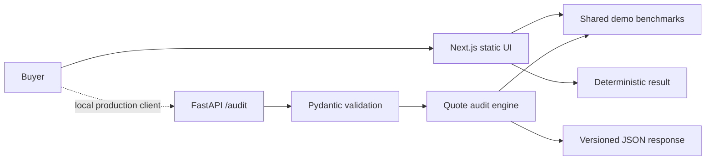

# Architecture

The public Pages deployment is frontend-only. The FastAPI service is local/tested source and performs a real domain operation: validation, nearest-benchmark selection, setting allowance, range comparison, and explicit risk flags.

## Shadow paths

- Missing/invalid amount or report ID → inline validation; API returns 422.
- Empty benchmark match → API catches lookup/configuration failure and returns a named 422 error.
- Slow UI operation → disabled action and visible loading copy.
- Clipboard denied → visible error while preserving the result.
- Stale fixtures → production design requires version and provenance; demo labels fictional values.

## Security and observability

No personal data, files, secrets, external APIs, analytics, or persistence exist in the demo. Production should redact invoices, encrypt evidence, constrain upload types, scan malware, audit reviewer access, and publish engine/benchmark versions. Track 422 rate, audit latency, reviewer overrides, refund rate, and band calibration against final transaction outcomes.
